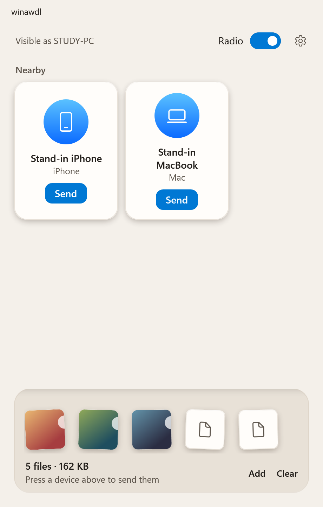
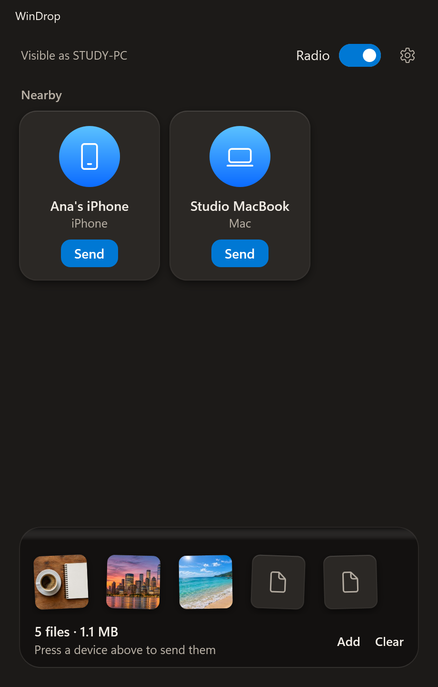
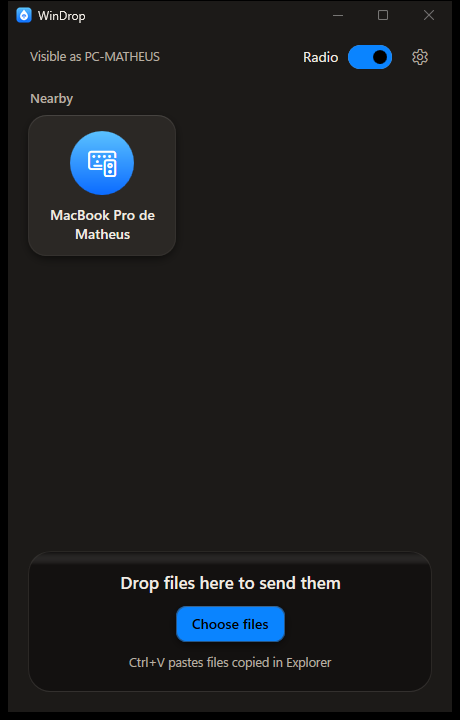

<p align="center">
  
</p>

<h1 align="center">WinDrop</h1>

<p align="center">
  AirDrop de verdade no Windows, pela placa Wi-Fi MediaTek MT7902.<br>
  Envia e recebe arquivos de iPhones e Macs falando AWDL, o protocolo sem fio do AirDrop.
</p>

<p align="center">
  
  
</p>

O WinDrop é um fork do [winawdl](https://github.com/raph559/winawdl), que faz AirDrop no Windows com uma placa Realtek RTL8852CE. Este fork troca o rádio: um driver em modo usuário para a **MediaTek MT7902**, escrito a partir do driver Linux mt76, que sobe o firmware da MediaTek, recebe e transmite quadros 802.11 crus e serve o mesmo protocolo de rádio que o resto do winawdl espera. Não usa servidor, nuvem nem aplicativo no iPhone: para os aparelhos Apple, o PC aparece no AirDrop como qualquer outro.

É código de pesquisa, feito e validado em uma máquina. Leia os [limites](#limites) antes de usar.

## O que funciona

Validado em 2026-11-16, em um desktop com a MT7902 (ASUS TUF GAMING A620M-PLUS WIFI), um MacBook Pro e um iPhone, todos no canal 149.

| Sentido | Resultado |
|---|---|
| PC para MacBook | 20 MB com SHA-256 idêntico nos dois lados |
| MacBook para PC | imagem arrastada no AirDrop do Mac, gravada em Downloads |
| iPhone para PC | foto enviada pela folha de compartilhamento |
| PC para iPhone | arquivo enviado e aceito no iPhone |

- **Botão direito no Explorer:** "Enviar via AirDrop" em qualquer arquivo.
- **Bandeja:** chave liga/desliga e opção de iniciar com o Windows já recebendo.
- **Sem pergunta do Windows ao ligar:** uma tarefa do sistema troca o driver da placa e sobe o rádio.
- **Wi-Fi de volta ao desligar:** em cerca de 10 segundos, com as redes salvas e reconectado.
- **Velocidade:** entre 3 e 5 MB/s do PC para o Mac a 1 metro (três envios de 20 MB).

## Telas

| Aparelhos por perto | Pedido de recebimento | Arquivo recebido |
|---|---|---|
|  |  |  |

As três imagens acima são renderizações do próprio aplicativo com aparelhos de exemplo (`winawdl.exe --render`). Esta é uma captura da cópia instalada, com um MacBook real por perto:

<p align="center">
  
</p>

## Casos de uso

- **Do iPhone para o PC, sem cabo e sem nuvem.** Fotos e vídeos saem da folha de compartilhamento do iPhone direto para a pasta Downloads do Windows.
- **Do PC para o iPhone ou o Mac.** Botão direito em um arquivo no Explorer, "Enviar via AirDrop", um clique no aparelho.
- **Entre o Mac e o PC na mesma mesa.** O PC aparece na janela do AirDrop do Finder como mais um aparelho.
- **Sem internet e sem rede em comum.** O AirDrop é ponto a ponto: funciona sem roteador, sem conta e sem aplicativo instalado no lado Apple.
- **PC sempre visível.** Com "Start with Windows, radio on", o WinDrop sobe com o Windows, sem janela, já recebendo.

## Tecnologias avaliadas e escolhidas

| Decisão | Avaliado | Escolhido | Motivo |
|---|---|---|---|
| Como falar com aparelhos Apple | LocalSend e similares (exigem aplicativo no iPhone); AirDrop real | AirDrop real, por AWDL | Era o requisito: aparecer no AirDrop nativo do iPhone e do Mac, sem instalar nada neles |
| Placa Wi-Fi | Trocar por uma Realtek RTL8852CE, que o winawdl já suporta; portar para a MT7902 da placa-mãe | Portar para a MT7902 | Não trocar hardware |
| Referência para o chip | Engenharia reversa do driver Windows da MediaTek; driver Linux mt76 | mt76 (caminho `mt7921e`) | Código aberto, e a MT7902 entrou nele no Linux 7.1 |
| Onde roda o driver | Driver de kernel próprio; modo usuário sobre o `regproxy` do winawdl | Modo usuário | Um erro derruba um processo, não o Windows; o `regproxy` (UMDF) já existia e funciona com Secure Boot |
| Memória para DMA | Memória contígua de kernel; páginas físicas travadas por AWE | AWE, em páginas de 4 KiB abaixo de 4 GiB | A placa só aceita endereços de 32 bits, e AWE dispensa código de kernel |
| Interrupções | Interrupções da placa; consulta periódica dos anéis | Consulta (polling) | Não exige nada do driver de kernel |
| Pilha AWDL | Escrever do zero; OWL | OWL, como no winawdl | Implementação aberta e já validada com aparelhos Apple |
| Interface de rede no Windows | Driver NDIS próprio; Wintun | Wintun | Assinado, estável e usado pelo winawdl |
| Como o rádio ganha privilégio | Elevação (UAC) a cada vez; direito "Bloquear páginas na memória" na conta; tarefa agendada como LocalSystem | Tarefa agendada, restrita à conta que instalou | Sem pergunta do Windows ao ligar, e sem exigir novo logon |
| Wi-Fi e AirDrop | Uso simultâneo (exigiria um cliente Wi-Fi completo próprio); troca do driver ao ligar e desligar | Troca do driver | O uso simultâneo está fora do alcance do projeto hoje |
| Taxa de transmissão | OFDM 24 e 54 Mb/s; VHT em 20 e 80 MHz | VHT MCS 7 em 80 MHz, fixa | A mais rápida entre as que completaram os envios de teste |

## Testes

**Por fase**, cada uma com um critério medido na máquina:

| Fase | Critério | Resultado |
|---|---|---|
| 1. Driver toma a placa | ler o identificador do chip | `chip id 0x7902` |
| 2. DMA e firmware | firmware da MediaTek rodando, sem interrupções | pronto em até 4 tentativas, 10 de 10 inicializações |
| 3. Recepção | quadros nos canais 6, 44 e 149 | incluindo quadros AWDL de aparelhos Apple |
| 4. Transmissão | testemunha independente no ar | MacBook em modo monitor capturou 30 de 30 quadros OFDM no canal 149 |
| 5. AWDL | tráfego IPv6 com um aparelho Apple | `ping` ao Mac pela `awdl0`: 10 de 10 |
| 6. AirDrop | arquivos nos dois sentidos, Mac e iPhone | quatro sentidos validados, um deles com SHA-256 |
| 7. Integração | cópia instalada, ligar, enviar, desligar | ciclo completo, Wi-Fi de volta em cerca de 10 s |

**Automatizados:**

- `airdrop/tests`: 84 testes, todos passando (`python -m unittest discover -s tests`).
- `scripts\build-app.ps1 -Check`: 134 de 135. O que falha procura uma mensagem do `ping.exe` em inglês e este Windows está em português; falha igual sem as mudanças deste fork.

**Ferramentas de teste do fork:** `mt7902/fwboot`, `rxtest`, `txtest` e `radioclient` (rádio), `scripts/sniff-test.ps1` (Mac como testemunha), `scripts/rate-trial.ps1` (velocidade por taxa), `scripts/app-radio-switch.ps1` e `scripts/app-send.ps1` (o aplicativo, por automação de interface).

## Benchmarks

Envios reais de um arquivo de 20 MB do PC para um MacBook Pro a cerca de 1 metro, pelo WinDrop instalado, um envio por medição:

| Taxa de dados | Velocidade |
|---|---|
| OFDM 24 Mb/s | 1,5 MB/s |
| OFDM 54 Mb/s | 1,1 MB/s |
| VHT MCS 8, 20 MHz | 3,1 MB/s |
| VHT MCS 5, 80 MHz | 3,4 MB/s |
| **VHT MCS 7, 80 MHz (padrão)** | **5,2, 5,1 e 3,1 MB/s** |
| VHT MCS 9, 80 MHz | 2,3 MB/s |

Outras medidas: `ping` de 1400 bytes ao Mac pela `awdl0` com 0% de perda e mediana de 150 ms; sinal do Mac e do iPhone entre -52 e -60 dBm; rádio no ar cerca de 15 s depois de ligar a chave; Wi-Fi de volta cerca de 10 s depois de desligar.

São poucas amostras, com um aparelho e uma distância. O sentido Apple para PC e o iPhone na taxa padrão ainda não foram medidos.

## Como funciona

```
Explorer / bandeja
        |
   WinDrop (WPF)  ---- engine.py: AirDrop (mDNS, HTTPS, BLE)
        |                         |
        |                     awdl0 (Wintun)
        |                         |
   tarefa do sistema  ---->  awdld: AWDL (OWL)
                                  |  pipe nomeado, radio_link.h
                             radiod: rádio da MT7902
                                  |  IOCTLs
                         winawdl_regproxy (UMDF) -> registradores e DMA da placa
```

- **`mt7902/`**: o que este fork acrescenta. Bring-up da placa, anéis de DMA por polling, carga do firmware, comandos MCU, modo monitor, transmissão com taxa fixa e o daemon `radiod`.
- **`awdl/`**: o daemon AWDL do winawdl sobre o [OWL](https://github.com/seemoo-lab/owl), sem alteração.
- **`airdrop/`**: receptor e remetente AirDrop em Python.
- **`app/`**: o aplicativo, com o botão direito, a chave na bandeja e o início com o Windows.
- **`driver/regproxy/`**: o driver UMDF que entrega a placa ao modo usuário.

O caminho completo, fase por fase, com o que deu errado e como foi resolvido, está em [docs/MT7902-PORT.md](docs/MT7902-PORT.md). O guia de uso está em [docs/WINDROP.md](docs/WINDROP.md).

## Limites

- **Wi-Fi e AirDrop não funcionam ao mesmo tempo no PC.** A placa é uma só: com o rádio ligado ela fala AWDL e o Wi-Fi do PC fica fora. Com cabo de rede o PC não perde a internet. O iPhone e o Mac não perdem nada.
- **Uma placa, uma máquina.** Só a MT7902 (`PCI\VEN_14C3&DEV_7902`), e só foi testado em um PC.
- **Só 5 GHz.** Em 2,4 GHz a placa só transmite a 1 Mb/s. O AirDrop usa o canal 149.
- **Velocidade modesta.** Taxa fixa, sem agregação nem adaptação: um aparelho longe demais para a taxa não recebe. O sentido Apple para PC não foi medido.
- **"Todos" no AirDrop.** O PC não é um contato da conta iCloud, então o iPhone precisa estar em "Todos por 10 minutos". Não há login com iCloud, "Somente contatos" nem Área de Transferência Universal: dependem de chaves que a Apple só emite para os aparelhos dela.
- **Fotos originais.** O receptor declara HEIF, HEVC e ProRes, como um Mac, para o iPhone não converter. Ainda falta confirmar com uma foto da câmera.
- **Arestas conhecidas.** O firmware às vezes pede parada do DMA ao subir (o rádio tenta de novo sozinho) e uma vez faltou memória física baixa para o DMA.

## Instalar

Requisitos: Windows 10 ou 11 de 64 bits, a placa MT7902, Python 3.10 ou mais novo e o .NET 10 Desktop Runtime. Para compilar: Visual Studio Build Tools com o WDK, o SDK do .NET 10 e MinGW-w64 (`winget install BrechtSanders.WinLibs.POSIX.UCRT --scope user`).

```powershell
git clone --recurse-submodules https://github.com/matheusbgodoi/WinDrop
cd WinDrop
git clone https://github.com/morrownr/mt76 ref\mt76     # firmware da MT7902
.\scripts\fetch-wintun.ps1
.\scripts\build-installer.ps1 -Build -AllowDirty
.\build\installer\winawdl-0.4.0\install.cmd             # pede administrador
```

A instalação assina o driver com um certificado criado no próprio PC, cria duas regras de firewall para endereços link-local, registra a tarefa que sobe o rádio e a que devolve o Wi-Fi na inicialização. `C:\Program Files\winawdl\uninstall.cmd` desfaz tudo.

## Usar

1. Abra o WinDrop pelo Menu Iniciar e ligue a chave **Radio**.
2. **Enviar:** botão direito em um arquivo, **Enviar via AirDrop**, e clique no aparelho. Ou arraste arquivos para a janela.
3. **Receber:** no iPhone ou no Mac, escolha o PC no AirDrop. O arquivo vai para Downloads.
4. Desligue a chave para o Wi-Fi do PC voltar.

## Créditos e licenças

- [winawdl](https://github.com/raph559/winawdl), de raph559: o projeto original, o aplicativo, o driver regproxy, o receptor AirDrop e o daemon AWDL para Windows. O README dele está em [docs/UPSTREAM-README.md](docs/UPSTREAM-README.md).
- [OWL](https://github.com/seemoo-lab/owl), do Secure Mobile Networking Lab: a implementação aberta do AWDL (GPL-3.0).
- [mt76](https://github.com/openwrt/mt76): o driver Linux que serviu de referência para a MT7902.
- [Wintun](https://www.wintun.net/), da WireGuard: a interface de rede virtual.

O código em `mt7902/` é BSD-3-Clause-Clear. O restante segue as licenças de cada pasta (`LICENSE` na raiz e em `awdl/`, `airdrop/`, `radio/`). O firmware da MediaTek não faz parte deste repositório.

AirDrop, AWDL, iPhone, Mac e iCloud são marcas da Apple. Este projeto não é afiliado à Apple nem à MediaTek.
