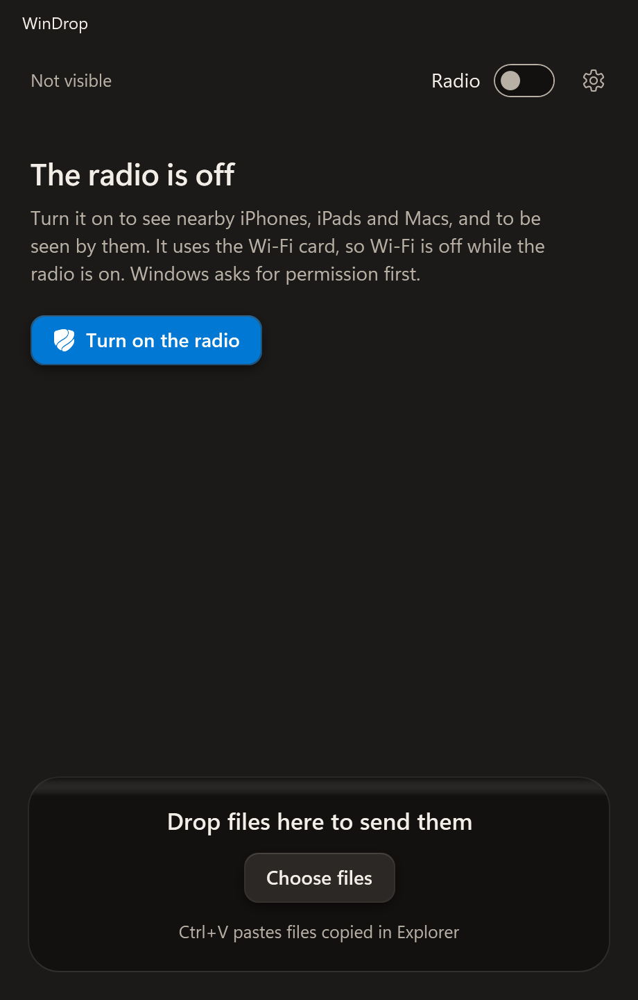
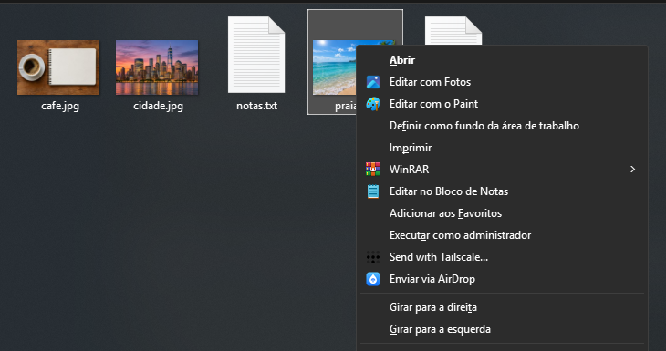
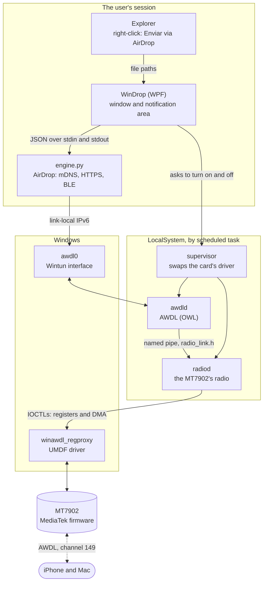
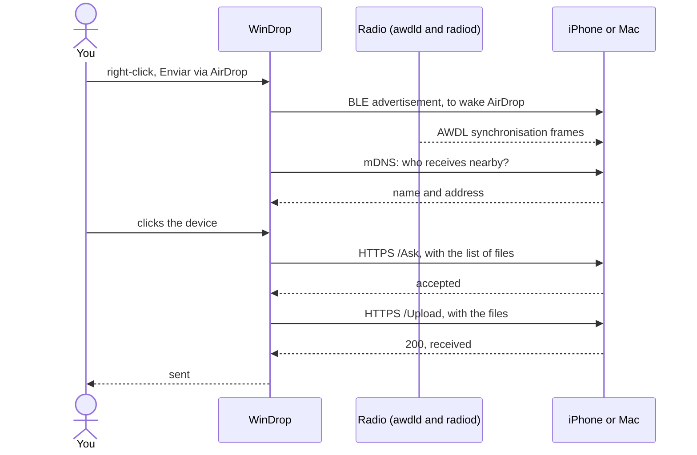
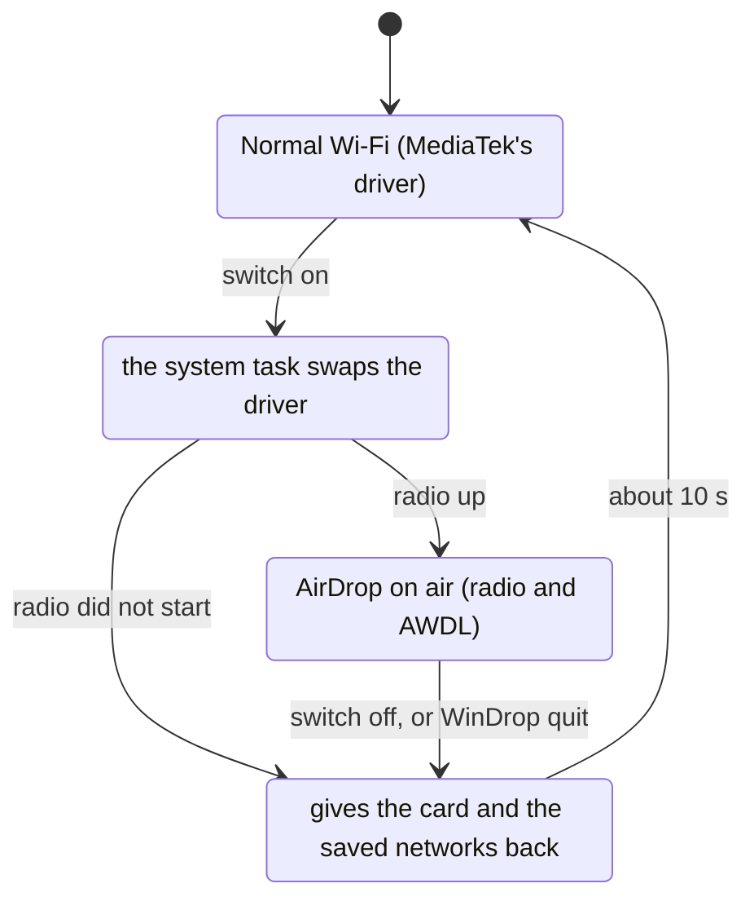

<p align="center">
  
</p>

<h1 align="center">WinDrop</h1>

<p align="center">
  Real AirDrop on Windows, through the MediaTek MT7902 Wi-Fi card.<br>
  Sends files to and receives them from iPhones and Macs by speaking AWDL, the wireless protocol under AirDrop.
</p>

<p align="center">
  <a href="README.pt-BR.md">Português</a>
</p>

<p align="center">
  
  
</p>

<p align="center"><sub>Left: a capture of the real window with a real MacBook. Right: a render of the app with a stand-in device.</sub></p>

WinDrop is a fork of [winawdl](https://github.com/raph559/winawdl), which does AirDrop on Windows with a Realtek RTL8852CE card. This fork swaps the radio: a user-mode driver for the **MediaTek MT7902**, written from the Linux mt76 driver, that boots MediaTek's firmware, receives and transmits raw 802.11 frames, and serves the radio protocol the rest of winawdl expects. No server, no cloud and no app on the iPhone: to Apple devices the PC shows up in AirDrop like any other.

This is research code, built and validated on one machine. Read the [limits](#limits) before you use it.

## What works

Validated on 2026-11-16 on a desktop with the MT7902 (ASUS TUF GAMING A620M-PLUS WIFI), a MacBook Pro and an iPhone, all on channel 149.

| Direction | Result |
|---|---|
| PC to MacBook | 20 MB with identical SHA-256 on both sides |
| MacBook to PC | an image dragged in the Mac's AirDrop, saved to Downloads |
| iPhone to PC | a photo sent from the share sheet |
| PC to iPhone | a file sent and accepted on the iPhone |

- **Right-click in Explorer:** "Enviar via AirDrop" on any file.
- **Notification area:** an on/off switch, and an option to start with Windows already receiving.
- **Runs in the background:** closing the window leaves it in the notification area, still receiving.
- **No question from Windows when turning on:** a system task swaps the card's driver and starts the radio.
- **Wi-Fi back when turned off:** in about 10 seconds, with the saved networks, reconnected.
- **Speed:** between 3 and 5 MB/s from the PC to a Mac a metre away (three 20 MB sends).

## Screens

| Files ready to send | An incoming request | A received file | Radio off |
|---|---|---|---|
|  |  |  |  |

These four are renders by the app itself (`winawdl.exe --render`) with the current version: the two devices are stand-ins, the files are the sample files of this repository. The theme follows Windows; in light it looks like this:

<p align="center">
  
</p>

Captures of the real window, with real devices, are in the demonstration below.

## Demonstration

A real send, from the PC to a MacBook, through the installed WinDrop. The four files are in [docs/assets/samples](docs/assets/samples): three AI-generated images made for this purpose and a text file.

<p align="center">
  
  
  
</p>

| 1. Files handed to WinDrop | 2. Request sent, waiting for the Mac to accept | When the device does not answer |
|---|---|---|
|  |  |  |

All three are captures of the real window, with the real MacBook in the list. After it accepted, the four files were in the Mac's Downloads with the same sizes in bytes as the originals (323165, 435805, 386271 and 120), at 1.6 MB/s. The third screen is from an earlier attempt, with the Mac's screen off.

### The right-click entry

WinDrop adds one entry, with its icon, to the right-click menu of every file. A capture of the real menu on the test PC, on one of the sample files:

<p align="center">
  
</p>

On Windows 11 it is in the full menu, under "Show more options" (or Shift + right-click): the short menu only takes entries from packaged apps. Several files chosen at once all land in the same WinDrop window.

## Use cases

- **iPhone to PC, no cable and no cloud.** Photos and videos go from the iPhone's share sheet straight to the Downloads folder on Windows.
- **PC to iPhone or Mac.** Right-click a file in Explorer, "Enviar via AirDrop", one click on the device.
- **Mac and PC on the same desk.** The PC shows up in Finder's AirDrop window as one more device.
- **No internet and no shared network.** AirDrop is peer to peer: it works with no router, no account and nothing installed on the Apple side.
- **A PC that is always there.** With "Start with Windows, radio on", WinDrop starts with Windows, with no window, already receiving.

## What was evaluated and what was chosen

| Decision | Evaluated | Chosen | Why |
|---|---|---|---|
| How to talk to Apple devices | LocalSend and the like (they need an app on the iPhone); real AirDrop | Real AirDrop, over AWDL | That was the requirement: to show up in the native AirDrop of the iPhone and the Mac, with nothing installed on them |
| Wi-Fi card | Swapping it for a Realtek RTL8852CE, which winawdl already supports; porting to the motherboard's MT7902 | Porting to the MT7902 | No hardware change |
| Reference for the chip | Reverse engineering MediaTek's Windows driver; the Linux mt76 driver | mt76 (the `mt7921e` path) | Open source, and the MT7902 entered it in Linux 7.1 |
| Where the driver runs | A kernel driver of its own; user mode on winawdl's `regproxy` | User mode | A mistake takes down a process, not Windows; `regproxy` (UMDF) already existed and works with Secure Boot |
| Memory for DMA | Contiguous kernel memory; physical pages locked through AWE | AWE, in 4 KiB pages below 4 GiB | The card only takes 32-bit addresses, and AWE needs no kernel code |
| Interrupts | The card's interrupts; polling the rings | Polling | Asks nothing of the kernel driver |
| AWDL stack | Writing one; OWL | OWL, as in winawdl | An open implementation already validated with Apple devices |
| Network interface on Windows | An NDIS driver of its own; Wintun | Wintun | Signed, stable and what winawdl uses |
| How the radio gets its privilege | Elevation (UAC) every time; the "Lock pages in memory" right on the account; a scheduled task as LocalSystem | A scheduled task, restricted to the account that installed | No question from Windows when turning on, and no need to sign in again |
| Wi-Fi and AirDrop | Both at once (it would take a complete Wi-Fi client of its own); swapping the driver on and off | Swapping the driver | Both at once is out of this project's reach today |
| Transmit rate | OFDM 24 and 54 Mb/s; VHT at 20 and 80 MHz | VHT MCS 7 at 80 MHz, fixed | The fastest among those that completed the test sends |

## Tests

**By phase**, each with a criterion measured on the machine:

| Phase | Criterion | Result |
|---|---|---|
| 1. The driver takes the card | read the chip's identifier | `chip id 0x7902` |
| 2. DMA and firmware | MediaTek's firmware running, with no interrupts | up within 4 attempts, 10 of 10 starts |
| 3. Reception | frames on channels 6, 44 and 149 | including AWDL frames from Apple devices |
| 4. Transmission | an independent witness on air | a MacBook in monitor mode captured 30 of 30 OFDM frames on channel 149 |
| 5. AWDL | IPv6 traffic with an Apple device | `ping` to the Mac over `awdl0`: 10 of 10 |
| 6. AirDrop | files both ways, Mac and iPhone | four directions validated, one of them by SHA-256 |
| 7. Integration | the installed copy: on, send, off | the whole cycle, Wi-Fi back in about 10 s |

**Automated:**

- `airdrop/tests`: 84 tests, all passing (`python -m unittest discover -s tests`).
- `scripts\build-app.ps1 -Check`: 134 of 135. The failing one looks for a message of `ping.exe` in English and this Windows is in Portuguese; it fails the same way without this fork's changes.

**The fork's own test tools:** `mt7902/fwboot`, `rxtest`, `txtest` and `radioclient` (the radio), `scripts/sniff-test.ps1` (a Mac as witness), `scripts/rate-trial.ps1` (speed by rate), `scripts/app-radio-switch.ps1` and `scripts/app-send.ps1` (the app, through UI Automation).

## Benchmarks

Real sends of a 20 MB file from the PC to a MacBook Pro about a metre away, through the installed WinDrop, one send per measurement:

| Data rate | Speed |
|---|---|
| OFDM 24 Mb/s | 1.5 MB/s |
| OFDM 54 Mb/s | 1.1 MB/s |
| VHT MCS 8, 20 MHz | 3.1 MB/s |
| VHT MCS 5, 80 MHz | 3.4 MB/s |
| **VHT MCS 7, 80 MHz (default)** | **5.2, 5.1 and 3.1 MB/s** |
| VHT MCS 9, 80 MHz | 2.3 MB/s |

Other measurements: `ping` of 1400 bytes to the Mac over `awdl0` with 0% loss and a median of 150 ms; signal of the Mac and the iPhone between -52 and -60 dBm; Wi-Fi back about 10 s after turning off.

These are few samples, with one device at one distance. The Apple-to-PC direction and the iPhone at the default rate have not been measured yet.

## How it works

### The parts



### A send, from the click to the delivery



### The Radio switch



### Folders

- **`mt7902/`**: what this fork adds. Card bring-up, polled DMA rings, firmware load, MCU commands, monitor mode, fixed-rate transmission and the `radiod` daemon.
- **`awdl/`**: winawdl's AWDL daemon on [OWL](https://github.com/seemoo-lab/owl), unchanged.
- **`airdrop/`**: the AirDrop receiver and sender, in Python.
- **`app/`**: the app, with the right-click entry, the switch in the notification area and the start with Windows.
- **`driver/regproxy/`**: the UMDF driver that hands the card to user mode.

The whole path, phase by phase, with what went wrong and how it was solved, is in [docs/MT7902-PORT.md](docs/MT7902-PORT.md) (in Portuguese). The usage guide is in [docs/WINDROP.md](docs/WINDROP.md) (in Portuguese).

## Limits

- **Wi-Fi and AirDrop do not work at the same time on the PC.** There is one card: with the radio on it speaks AWDL and the PC's Wi-Fi is off. On a network cable the PC keeps its internet. The iPhone and the Mac lose nothing.
- **One card, one machine.** Only the MT7902 (`PCI\VEN_14C3&DEV_7902`), and it has been tested on one PC.
- **5 GHz only.** On 2.4 GHz the card only transmits at 1 Mb/s. AirDrop uses channel 149.
- **Modest speed.** A fixed rate, no aggregation and no adaptation: a device too far for the rate receives nothing. The Apple-to-PC direction has not been measured.
- **"Everyone" in AirDrop.** The PC is not a contact of the iCloud account, so the iPhone has to be on "Everyone for 10 Minutes". There is no iCloud sign-in, no "Contacts Only" and no Universal Clipboard: they depend on keys Apple only issues to its own devices.
- **Original photos.** The receiver declares HEIF, HEVC and ProRes, as a Mac does, so that the iPhone does not convert. This still has to be confirmed with a photo from the camera.
- **Known rough edges.** The firmware sometimes asks for a DMA stop as it starts (the radio tries again by itself) and once there was not enough low physical memory for DMA.

## Install

**With the installer:** download `WinDrop-0.5.0-setup.exe` from [Releases](https://github.com/matheusbgodoi/WinDrop/releases) and run it. It checks that the PC has the MT7902 and stops, having changed nothing, if it does not. WinDrop says when there is a newer version; updating is running the new installer over the old one.

It is not for every Windows PC: only for those with the **MediaTek MT7902**. The installer is not signed by a certificate authority, so SmartScreen may warn when it opens. It has been tested on this PC, updating a copy already installed; a first install on another machine has not been tested yet.

**Building from source:**

Requirements: 64-bit Windows 10 or 11, the MT7902 card, Python 3.10 or newer and the .NET 10 Desktop Runtime. To build: Visual Studio Build Tools with the WDK, the .NET 10 SDK and MinGW-w64 (`winget install BrechtSanders.WinLibs.POSIX.UCRT --scope user`).

```powershell
git clone --recurse-submodules https://github.com/matheusbgodoi/WinDrop
cd WinDrop
git clone https://github.com/morrownr/mt76 ref\mt76     # the MT7902's firmware
.\scripts\fetch-wintun.ps1
.\scripts\build-installer.ps1 -Build -AllowDirty
.\build\installer\winawdl-0.5.0\install.cmd             # asks for administrator rights
```

Installing signs the driver with a certificate made on the PC itself, adds two firewall rules for link-local addresses, and registers the task that runs the radio and the one that gives Wi-Fi back at startup. `C:\Program Files\winawdl\uninstall.cmd` undoes all of it.

## Use

1. Open WinDrop from the Start Menu and turn the **Radio** switch on.
2. **Send:** right-click a file, **Enviar via AirDrop**, and click the device. Or drag files onto the window.
3. **Receive:** on the iPhone or the Mac, pick the PC in AirDrop. The file goes to Downloads.
4. Closing the window leaves WinDrop in the notification area, still receiving. **Quit** in the icon's menu ends it.
5. Turn the switch off for the PC's Wi-Fi to come back.

To have it there from sign-in, tick **Start with Windows, radio on** in the menu of the icon in the notification area. It is off until you tick it.

## Credits and licences

- [winawdl](https://github.com/raph559/winawdl), by raph559: the original project, the app, the regproxy driver, the AirDrop receiver and the AWDL daemon for Windows. Its README is in [docs/UPSTREAM-README.md](docs/UPSTREAM-README.md).
- [OWL](https://github.com/seemoo-lab/owl), by the Secure Mobile Networking Lab: the open implementation of AWDL (GPL-3.0).
- [mt76](https://github.com/openwrt/mt76): the Linux driver that was the reference for the MT7902.
- [Wintun](https://www.wintun.net/), by WireGuard: the virtual network interface.

**Noncommercial use, with the source credited.** This fork's original work (the `mt7902/` folder, the name, the logo, the documentation and the changes made to the original project) is under the [PolyForm Noncommercial License 1.0.0](LICENSE-WINDROP.md): you may use, study, modify and redistribute it for noncommercial purposes, keeping the notice of authorship; you may not sell it or build it into a paid product.

What comes from other projects stays under its original licence (MIT for winawdl, GPL-3.0 for the AWDL daemon), and this fork cannot restrict those. [LICENSING.md](LICENSING.md) says which licence covers which part. MediaTek's firmware is not part of this repository.

AirDrop, AWDL, iPhone, Mac and iCloud are trademarks of Apple. This project is not affiliated with Apple or MediaTek.
