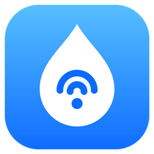
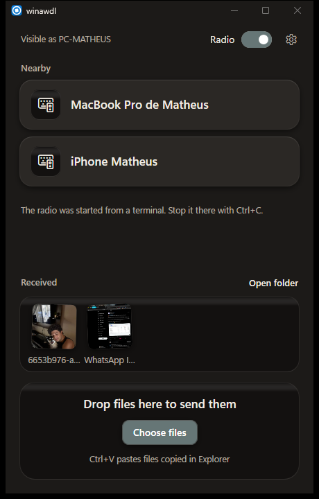
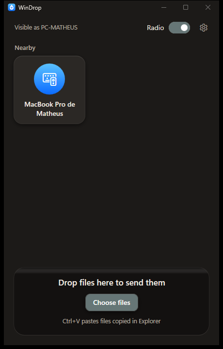
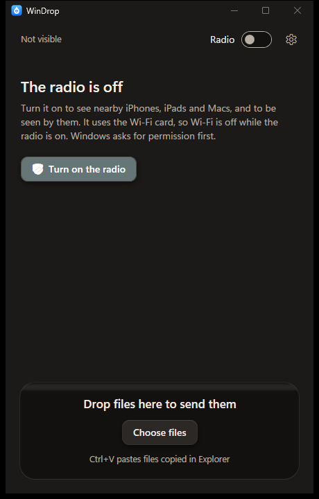
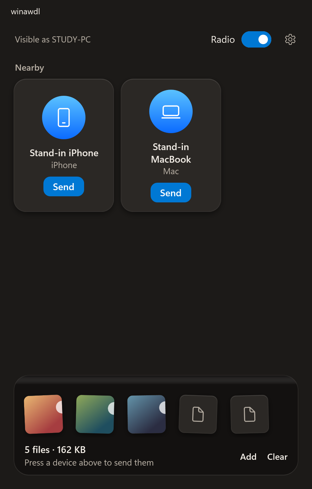
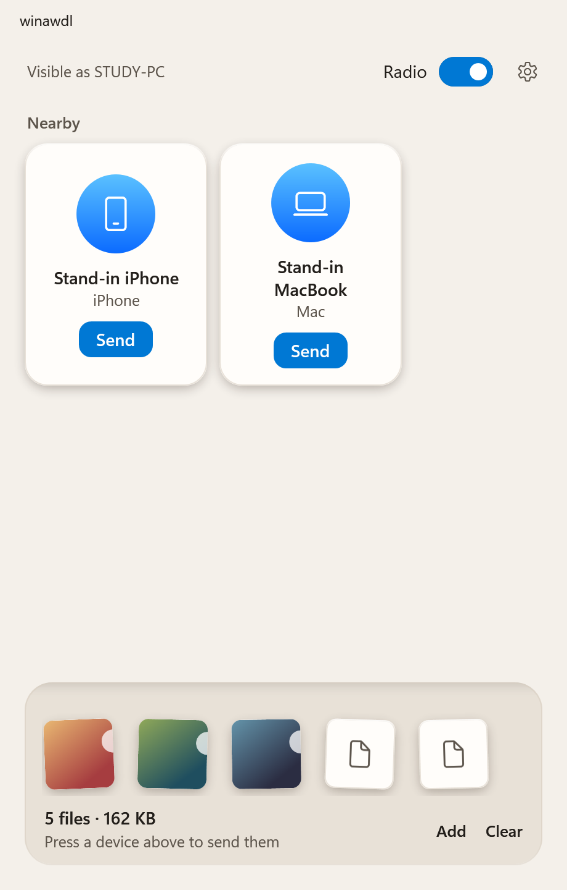

# WinDrop

AirDrop de verdade no Windows, sobre a placa MediaTek MT7902 deste PC. O WinDrop é o aplicativo do projeto winawdl com o rádio trocado: fala AWDL, o protocolo sem fio do AirDrop, e aparece para iPhones e Macs como um aparelho Apple apareceria.

O logo é um desenho próprio (`assets/windrop.svg`): uma gota que carrega um sinal. `tools/make-icon.py` gera o ícone do aplicativo a partir das mesmas formas.

Estado em 2026-11-16. O histórico técnico, fase por fase, está em [MT7902-PORT.md](MT7902-PORT.md).

A visão geral do projeto, com a demonstração de um envio real, as decisões técnicas, os testes e os benchmarks, está no [README](../README.md). Este guia cobre o uso no dia a dia.

## O que foi validado

| Sentido | Resultado |
|---|---|
| PC para MacBook | Arquivo de 20 MB, SHA-256 idêntico nos dois lados; hoje entre 3 e 5 MB/s |
| MacBook para PC | Imagem de 104425 bytes arrastada no AirDrop do Mac, gravada em Downloads |
| iPhone para PC | Foto de 105043 bytes enviada pela folha de compartilhamento |
| PC para iPhone | Arquivo enviado e aceito no iPhone |

Todos os testes foram no canal 149 (5 GHz), com o iPhone e o Mac em "Todos".

## Telas

Com o rádio ligado, o MacBook aparece em "Nearby" e um arquivo recebido fica na prateleira "Received" (captura feita antes da troca de nome, por isso o título antigo):

Com o rádio ligado pela cópia instalada, já com o nome novo:

Com o rádio desligado, o Wi-Fi do PC funciona normalmente:

A lista de aparelhos foi redesenhada: um rosto redondo para cada aparelho, lado a lado, com o nome embaixo. Estas duas imagens são renderizações do próprio aplicativo com aparelhos de exemplo (`winawdl.exe --render`); a captura "Rádio ligado" acima é da cópia instalada, com o MacBook real:

## Como usar

1. Abra o WinDrop pelo Menu Iniciar. Ele fica na bandeja, ao lado do relógio.
2. Ligue a chave **Radio** (na janela, ou em **AirDrop** no menu do ícone da bandeja). Não há pergunta do Windows: uma tarefa do sistema troca o driver da placa e sobe o rádio.
3. Para enviar: botão direito em um arquivo no Explorer, **Enviar via AirDrop**, e clique no aparelho. Também dá para arrastar arquivos para a janela.
4. Para receber: no iPhone ou no Mac, escolha o PC no AirDrop. O arquivo vai para Downloads e o WinDrop avisa no canto da tela.
5. Para o WinDrop já subir com o Windows, sem janela e recebendo, marque **Start with Windows, radio on** no menu do ícone da bandeja. Neste PC isso está ligado.
6. Desligue a chave para o Wi-Fi voltar. As redes salvas são trazidas de volta e o WinDrop pede ao Windows para entrar na última usada.

No iPhone, o AirDrop precisa estar em "Todos por 10 minutos", com a tela acesa: o PC não é um contato da conta iCloud.

## Limites conhecidos

Estes pontos não estão resolvidos, e alguns não têm solução à vista.

- **Wi-Fi e AirDrop não funcionam ao mesmo tempo no PC.** A placa é uma só: com o rádio ligado ela fala AWDL e o Wi-Fi do PC fica fora; com o rádio desligado, o contrário. Com cabo de rede o PC não perde a internet. O iPhone e o Mac não perdem nada em nenhum caso. Uso simultâneo exigiria um driver Wi-Fi completo próprio para a MT7902, o que está fora do alcance deste projeto hoje.
- **Velocidade.** Entre 3 e 5 MB/s do PC para o Mac (20 MB, a 1 m), com taxa fixa VHT em 80 MHz; eram 1,1 a 1,5 MB/s. Sem agregação nem adaptação de taxa: um aparelho longe demais para essa taxa não recebe. O sentido contrário não foi medido.
- **Só 5 GHz.** Em 2,4 GHz a placa só põe no ar quadros a 1 Mb/s. O AirDrop usa o canal 149.
- **Formatos originais.** O receptor passou a declarar HEIF, HEVC e ProRes, como um Mac, para o iPhone mandar os arquivos sem converter. A declaração foi copiada da resposta de um Mac; ainda falta conferir com uma foto da câmera se o original chega. Live Photos e históricos de edição seguem de fora.
- **Conta iCloud.** Não há login com iCloud. "Somente contatos" e a Área de Transferência Universal dependem de certificados e chaves que a Apple emite só para aparelhos dela, por meio de serviços privados. Imitar um aparelho Apple nesses serviços viola os termos da conta e pode bloqueá-la; o projeto não faz isso. Compartilhar a área de transferência por um caminho próprio (um atalho no iPhone e um agente no Mac) é possível, mas não seria o recurso da Apple.
- **Aparência.** A janela é a do winawdl, com identidade própria. O projeto não copia o ícone nem as telas da Apple.
- **Memória para DMA.** Uma vez o rádio não subiu por falta de memória física livre abaixo de 4 GiB; na tentativa seguinte subiu.
- **Estabilidade do boot do firmware.** O firmware às vezes pede parada do DMA logo após subir; o rádio tenta de novo sozinho, até oito vezes.

## Instalar e remover

`scripts\build-installer.ps1 -Build` monta a cópia em `build\installer` e `install.cmd` dentro dela instala em `C:\Program Files\winawdl`. A instalação:

- assina o driver `winawdl_regproxy` com um certificado criado no próprio PC e o põe nas raízes confiáveis;
- cria duas regras de entrada no firewall, só para endereços link-local (TCP 8771 e UDP 5353);
- registra uma tarefa que devolve o Wi-Fi na inicialização, se a placa tiver ficado com o WinDrop;
- registra a tarefa `winawdl radio`, que roda o rádio como LocalSystem quando a chave é ligada;
- concede "Bloquear páginas na memória" à conta (usado só pelo fluxo de desenvolvimento).

`C:\Program Files\winawdl\uninstall.cmd` desfaz tudo isso.
